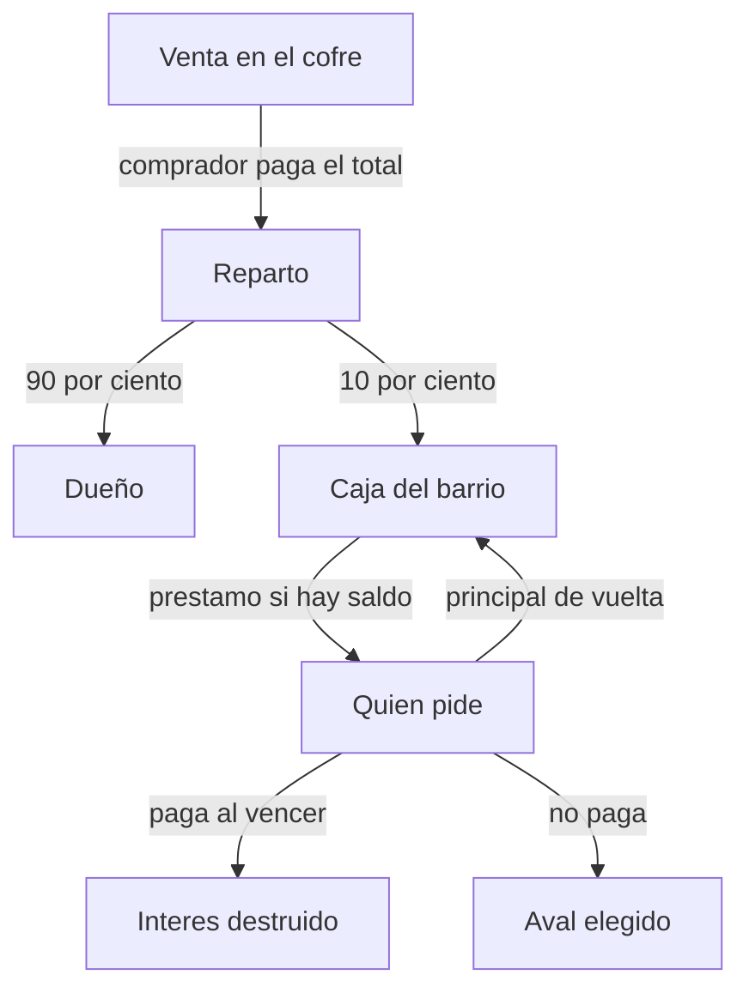

# Tienda en la parcela y banco

Solo dos cosas. La recolección de LLorosBlaster (Sebas) no lleva sistema aparte: junta troncos, minerales o esmeraldas y los mete en su cofre al precio que quiera. Quien pase compra la cantidad que le haga falta.

- **Cofre de venta.** Un bloque nuevo en tu parcela. El dueño mete objetos y les pone duros por unidad. Quien compra elige la cantidad y el total sale solo. El barrio se queda un 10 %.
- **Banco.** Botón nuevo en el Panel Preguntones. Presta duros de la caja del barrio. El jugador escribe el importe, hasta lo que haya en la caja, elige el plazo y acepta el interés que se le enseña. Si no paga, se ejecuta el aval que eligió.

El botón Tienda del panel no cambia: sigue siendo adornos y la bandera (`/puesto`). El cofre de la parcela se llama **Cofre de venta** para no mezclarlos. `/pay` sigue existiendo para pasarse duros a mano.

## De dónde salen los duros del banco

El banco no fabrica duros en cada préstamo. Presta lo que hay en la **caja del barrio**.

- Cada venta del cofre mete ahí el 10 %, redondeado hacia abajo. En una venta de 4 duros la caja se queda 0; en una de 40, se queda 4.
- El 10 % de vender una parcela, que hoy desaparece, pasa también a la caja.
- El interés que alguien paga no entra en la caja: se destruye. Pedir prestado quita duros del mundo. La caja solo crece con impuestos.
- El capital devuelto vuelve a la caja y se puede prestar otra vez.
- Para que el primer día no esté vacío, la caja nace una sola vez con **150 duros**. No se repone al reiniciar. Con la caja a 0, el banco dice cuántos hay y no deja pedir.

Un préstamo de 100 a 7 días cuesta 30 de interés. Esos 30 se borran al pagar. Los 100 vuelven a la caja.

## 1. Cofre de venta

Se craftea con cuatro lingotes de oro, un cofre y un cartel de roble. Es un objeto, no un permiso. Sin el pack se ve el barril y el rótulo «Venta»; con el pack, el modelo de abajo.

### Colocarlo

Solo en una parcela tuya, en el mundo del barrio. No en la de un amigo, ni en un camino, ni en el spawn, ni en el survival. Tampoco en una parcela que esté de aval o en venta. Máximo **4** por parcela. El bloque real es un barril: dos cofres vanilla se juntan y el barril no. Encima va el modelo y un rótulo fijo que dice «Venta», para quien no tenga el pack.

El dueño lo abre con shift y clic. Cualquier otro clic abre la compra. Un amigo de la parcela construye alrededor, pero no mete, no saca y no cambia precios.

### Dueño

Inventario de 27. Arriba, 18 huecos de género. Abajo, el saldo y «Cerrar».

- Pasas objetos de tu inventario a un hueco. Hasta que no tienen precio, el comprador no los ve. El nombre sale «Sin precio».
- Clic en un hueco abre un yunque con el número. Precio **por unidad**, de 1 a 500. Letras, cero, vacío o más de 500 se rechazan y el género no se toca.
- Dos huecos pueden ser el mismo material a distinto precio, o uno liso y otro encantado. No se mezclan.
- Shift y clic devuelve ese hueco a tu inventario. Si no cabe, no se saca.
- No se puede meter el propio Cofre de venta, ni bloques de mando, ni barrera, ni el bastón de debug. Un shulker se vende entero, con lo que lleve dentro. Una herramienta dañada se vende en ese estado.
- Tolvas, vagonetas, dosificadores y soltadores no meten ni sacan. Los pistones no lo empujan. El dueño no puede romperse el barril si queda género: antes lo vacía. Al romperlo vacío, el objeto vuelve.

### Comprador

Ve solo huecos con precio y stock. Clic en uno abre la cantidad, no se lleva el objeto.

- Botones −64, −10, −1, +1, +10, +64. El centro enseña el objeto, las unidades y el total.
- Total = unidades × precio de ese hueco. No suma otros huecos: si hace falta otro stack, se compra aparte.
- El tope de una compra son **2000 duros**, el mismo que una parcela. Si el siguiente +10 se pasa, el botón no sube y lo dice.
- La línea de abajo dice las tres cifras: «Pagas 40. El barrio se queda 4. Recibe 36.» El comprador paga el total, no el total más el impuesto.
- Confirmar quita los duros, parte el stack, entrega y paga. Si no cabe en el inventario o el stock cambió, no se cobra nada.
- No puedes comprarte a ti mismo.

Ejemplo de Sebas: roble a 4 duros. Alguien se lleva 10 y paga 40. Un stack serían 256, y el menú lo enseña antes de cobrar.

### Arte del cofre

Pack opcional en `pack/`. Quien lo rechace sigue pudiendo comprar: ve el barril, el rótulo «Venta» y el inventario vanilla. Quien lo acepte ve el modelo tapando el barril.

El modelo cabe en un bloque, opaco, un poco más grande que el barril para taparlo. Siempre iluminado, para que de noche se lea desde el camino. Sonido de cofre, no de barril. Partículas de roble al romperlo.

Textura a 32×32, pixel art, sin degradados ni relieve:

- Cuerpo de roble (`#C29A62`, `#A67C52`) con contorno oscuro `#3A2A1C`, como un objeto vanilla.
- Una franja de oro `#E6B84D` en la tapa, el mismo oro del botón PVP y de las banderas.
- Cierre de esmeralda `#3DDC7A` con filo de oro: el verde del interrogante del logo.
- En el frente, un interrogante de oro de cinco píxeles. El punto es cian `#7EE7F0`, el punto del logo. No hay más texto en la textura.
- El objeto en la mano usa el mismo modelo, con el nombre «Cofre de venta» y el lore «Ponlo en tu parcela. Lo que metas, se vende.»

El inventario de compra no lleva textura propia. Sigue el cofre vanilla, como `/puesto`. Pepita de oro para el precio, papel para el total, tinte verde para comprar, tinte rojo para volver.

El `item_model` es `preguntones:cofre_venta`. El formato del pack se confirma con el cliente 26.1.2 el día que se empaquete, no se inventa el número.

## 2. Banco

Botón **Banco** en el panel, color `#E6B84D`, ayuda «Pedir duros. Se devuelven con intereses.» Queda después de Tienda. El texto del panel pasa a nombrar el banco. Se añade en los dos sitios que abren el panel: el diálogo `preguntones:panel`, si ese comando es el que ve la gente, y el menú de `tools/viajes/src/com/preguntones/viajes/MenuPantalla.java`, que es el respaldo.

No teletransporta y no mira si hay peligro. Se puede abrir en cualquier momento. No tiene modelo 3D: es el mismo diálogo que Spawn o Survival. El cuerpo puede enseñar una pepita de oro.

### Qué se acepta

Un solo préstamo a la vez. Se escribe la cantidad, de **1** hasta lo que haya en la caja. Letras, cero o más que la caja se rechazan y no se aparta nada. Si la caja está vacía, no deja pedir.

El interés no se negocia. El jugador elige un plazo y, en la última pantalla, acepta el número:

- 1 día, **10 %**
- 3 días, **20 %**
- 7 días, **30 %**

El interés se redondea al duro de arriba, y como mínimo es **1 duro**. Así un préstamo siempre cuesta. 25 al 10 % son 3 de interés, no 2: se deben 28. La pantalla lo escribe antes de aceptar.

Esa pantalla es el contrato. Dice importe, plazo, hora peninsular de vencimiento, total, y la frase exacta de qué se quita si no se paga. Sin esa aceptación no sale ningún duro. Cerrar con Escape no aparta nada.

Pagar antes, desde el mismo botón, cuesta el total ya aceptado. No se descuenta por devolverlo pronto: el precio era el del plazo elegido. No hay pagos a medias.

### Qué aval, según la cantidad

El aval se elige al pedir, no al vencer. Hay dos, y el banco solo ofrece el que corresponde.

- **Hasta 50 de capital: aval en duros.** No hace falta parcela. Recibes el dinero ya. Si al vencer no está el total, el banco se queda con el saldo que tengas, hasta cubrir la deuda, y lo devuelve a la caja. Lo que falte sigue debiéndose. Mientras debas, no puedes pedir otro, ni usar `/pay`, ni comprar en un cofre de venta, ni reclamar o comprar parcelas. Los duros que te entren (una venta tuya, la XO, alguien que intente pagarte) saldan la deuda primero. Cuando llegas a cero de deuda, se acaba el bloqueo. No se toca ninguna parcela: es poco dinero para quedarse con una casa.
- **Más de 50, o quien prefiera no dejar la deuda abierta: aval de una parcela.** Eliges cuál de las tuyas. Recibes el dinero ya y esa parcela queda bloqueada: no se vende, no se abandona, no se ofrece. Al vencer, primero se cobra de tu saldo. Si llega, la parcela se suelta. Si no llega, la parcela vuelve al barrio: borde amarillo, la obra se queda, los amigos de esa parcela se quitan. El siguiente la reclama con la pala, al precio normal, y ese precio entra en la caja. La deuda se da por cerrada aunque la parcela valga menos: no te quedas sin casa y encima debiendo. El género de los cofres de venta de esa parcela no pasa al barrio: se guarda y te lo devuelve `/tienda recuperar`, o al entrar si cabía.

Si la parcela elegida es la única, el botón de aceptar lo dice y hay una segunda pantalla: «Es tu única parcela. Si no pagas, deja de ser tuya.» Se puede hacer. No se esconde.

No se puede avalar una parcela en venta, la de otra persona, ni una que ya esté avalando. Hace falta tenerla desde antes de abrir Pedir: una parcela reclamada en medio del diálogo no sale en la lista. Así el préstamo no se usa para comprar una parcela y avalarla al momento en cadena.

### Arte del banco

Nada nuevo en el mundo. Mismos márgenes que el resto del panel: título `#F4F7FB`, cuerpo `#C5CED8`, aceptar `#8FE3A0`, el confirm de perder la parcela `#E07A7A`. Esos verdes y rojos ya están en el duelo del PVP.

## Casos límite del cofre

- **Sitio.** Fuera del barrio, en el survival, en el End, en un camino, en el spawn, en parcela ajena o de un amigo: el objeto vuelve a la mano y dice por qué. Dentro de un bloque, o donde no hay suelo: no se coloca.
- **Parcela en venta o de aval.** No se coloca. Si la parcela pasa a aval con cofres ya puestos, siguen vendiendo hasta el vencimiento.
- **Cuatro cofres.** El quinto no se coloca: el objeto sigue en la mano.
- **Dueño desconectado.** Se puede comprar. Los duros entran en su cuenta.
- **Dos compradores a la vez.** El cofre se atiende de uno en uno. El segundo recibe «Alguien está mirando» o, si ya cerró, el stock nuevo. Nunca se vende dos veces el mismo objeto.
- **El dueño saca el stack mientras el otro elige cantidad.** Al confirmar, si ya no hay bastante, no se cobra y se vuelve al género que queda.
- **Inventario lleno.** No se cobran duros y el género no se parte.
- **Saldo justo, y el total cambia.** Se vuelve a mirar el precio guardado en ese momento, no el que había al abrir.
- **Desconexión con el menú abierto.** El objeto del cursor vuelve a quien lo tenía. Nada queda a medias.
- **Clics.** El comprador no puede sacar con shift, ni soltar, ni arrastrar, ni usar números para cambiar de mano. El dueño sí mueve género entre su inventario y los 18 huecos.
- **Precios.** Vacío, letras, negativos, 0 y más de 500 no se guardan. El total que pasaría de 2000 no deja subir la cantidad.
- **Redondeo.** 10 % hacia abajo. Se enseña antes. El dueño recibe el resto. Si el depósito al dueño falla, se devuelven los duros y el género.
- **Objetos raros.** Se conserva encantamiento, nombre, daño, poción y contenido del shulker. Se rechaza el cofre de venta anidado y los bloques de staff. Un libro firmado se vende como objeto, sin ejecutar lo que lleve escrito.
- **Dupe.** Primero se quita de la mano o del hueco, luego se guarda. Si guardar falla, se devuelve. El barril vanilla está vacío: la lista verdadera es del plugin. Romper el barril a mano no suelta el género.
- **Mundo.** Pistón, explosión, enderman, fuego y líquido no se lo llevan. Al cargar, si el barril ya no está, el género queda para `/tienda recuperar` y no se vende en el aire.
- **Vender o abandonar la parcela.** Bloqueado mientras haya un cofre colocado. El mensaje dice que lo quites. Vacío se puede recoger; con género, primero se vacía.
- **Reinicio a mitad de una compra.** La compra no queda a medias: o se guardó entera o no se cobró.
- **Operador en creativo.** Puede hacerse trampas. No se intenta impedirlo.

## Casos límite del banco

- **Caja corta.** No deja pedir más de lo que hay. Si dos personas aceptan el último préstamo a la vez, una se queda sin él y no se le aparta el aval.
- **Ya debes.** Pedir no está. Está Pagar, con el total y la hora.
- **Cerrar el diálogo.** No hay préstamo a medias ni parcela bloqueada.
- **Saldo al vencer, aval en duros.** Se cobra solo hasta el total. Si hay de más, se queda. Si no llega, se cobra lo que haya y el resto bloquea `/pay`, compras, parcelas nuevas y otro préstamo. Entrar más tarde enseña lo que falta.
- **Alguien te pasa duros mientras debes.** Esos duros saldan antes de entrar en tu saldo. Si tapan la deuda, el bloqueo se levanta.
- **Aval de parcela y sí tienes saldo.** Se cobra del saldo y la parcela no se toca.
- **Aval de parcela y no llega.** Pasa al barrio solo esa parcela. Las demás siguen tuyas. La deuda no continúa. Los cofres de venta de esa parcela se recogen a tu favor.
- **La parcela desaparece antes de vencer.** Si la vendiste por un bug o un admin, el préstamo se trata como aval en duros: se cobra del saldo y el resto queda bloqueado. No se busca otra parcela que no elegiste.
- **Única parcela.** Segunda confirmación. Sigue siendo posible.
- **Parcela reclamada durante el diálogo.** No aparece. Tampoco una que esté en venta.
- **Hora.** El plazo se cuenta en instante real, no en el reloj del mundo. Se enseña en hora peninsular. El cambio de hora de verano no alarga ni acorta el plazo.
- **Desconectado, baneado o sin entrar.** El vencimiento corre igual. Al entrar, un mensaje dice si se cobró, si sigues debiendo o si la parcela ya no es tuya.
- **Pagar dos veces.** La segunda dice que no debes nada y no cobra.
- **Reinicio con uno ya vencido.** Al arrancar se ejecuta antes de que nadie pueda pedir.
- **Decimales de Essentials.** Se usan duros enteros, como en las parcelas.
- **Staff.** Puede condonar si un contrato se rompió. Los dos, caja y jugador, se enteran. No hay un botón público de perdón.

## Qué no se hace

- Encargos, préstamos entre jugadores, ni un recaudador. Eso queda cubierto por el cofre.
- El servidor comprando madera a un precio fijo.
- Quitar el inventario, el cofre del End u otra parcela que no sea el aval.
- Un edificio de banco en el spawn.
- Subastas, intereses que se acumulan cada día, o más de un préstamo a la vez.

## Dónde vivirá el código

El cofre y la caja viven en el plugin de parcelas, que ya cobra y protege. El botón vive en Viajes, en el panel. El pack vive en `pack/`. El cuaderno gana una página corta, «Vender» y «Banco», cuando eso esté en el juego. El texto de Discord no cambia antes.
